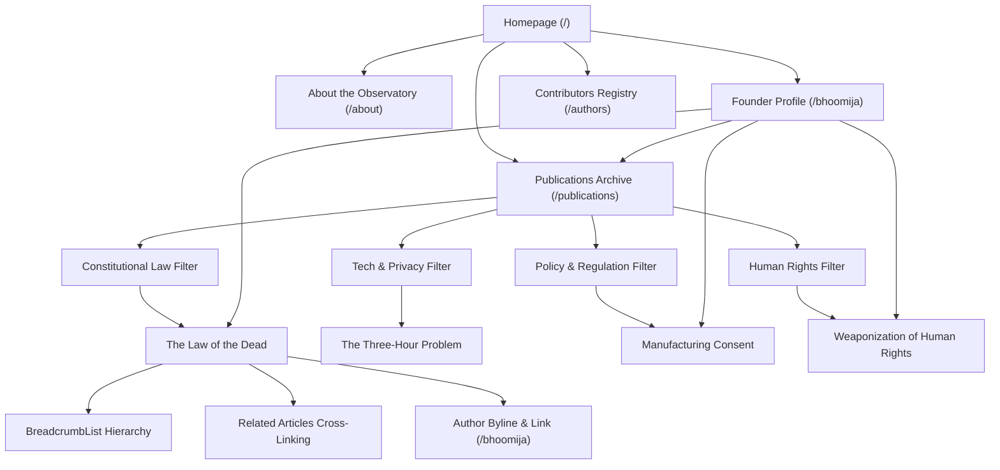

# National Legal Observatory (NLO) — SEO Masterplan & Technical Blueprint

**Target Production Domain**: `https://legal-observatory.vercel.app`  
**Organisation**: National Legal Observatory (NLO)  
**Founder & Research Director**: Bhoomija Khanna  
**Audit Date**: October 27, 2026  
**Implementation Status**: High-Value Technical & Structural Improvements Implemented & Verified Locally  

---

## 1. Executive Summary & Domain Governance

The **National Legal Observatory (NLO)** is an independent, non-partisan legal research platform and constitutional think tank publishing structured reviews, case commentaries, and legislative analyses covering Indian and comparative jurisprudence.

### 1.1 Canonical Domain Resolution
Prior to this masterplan, internal links and metadata references contained fragmented hostnames (e.g. `https://legal-observatory.org`, `thenlo.org`, and `https://legal-observatory.vercel.app`).
- **Authoritative Canonical Origin**: `https://legal-observatory.vercel.app`
- **Resolution**: All `metadataBase`, XML sitemaps, robots configurations, Open Graph URLs, and JSON-LD structured identities have been standardized strictly to `https://legal-observatory.vercel.app`.
- **Enforcement**: No placeholder or unconfigured external domains are permitted.

---

## 2. Comprehensive SEO Audit

### 2.1 Technical SEO & Crawlability Audit
| Audit Area | Pre-Implementation State | Implemented State | Impact |
|---|---|---|---|
| **`robots.txt`** | Missing (returned 404) | Implemented dynamic handler at `/src/app/robots.ts` with explicit rules for search crawlers, AI agents (`GPTBot`, `Google-Extended`), disallow paths (`/cms/`, `/api/`, `/_next/`, `/bhoomija/research/`), and linked sitemap | High |
| **XML Sitemap** | Missing (returned 404) | Implemented dynamic handler at `/src/app/sitemap.ts` auto-indexing all 10 core routes, 11 published research articles, and verified author profiles with accurate `lastmod`, `changefreq`, and priority scoring | High |
| **`metadataBase`** | Configured to unverified `legal-observatory.org` | Standardized to `https://legal-observatory.vercel.app` in `src/app/layout.tsx` | Critical |
| **Canonical URLs** | Missing on homepage, publication pages, about, and authors | Explicit self-referencing canonical tags injected across all static and dynamic routes (`/`, `/about`, `/publications`, `/authors`, `/bhoomija`, `/publications/[category]/[slug]`) | High |
| **HTTP Security Headers** | CSP, Permissions-Policy, nosniff | Hardened with HSTS (`max-age=63072000; includeSubDomains; preload`), `X-Frame-Options: DENY`, and `X-XSS-Protection` | Medium |
| **PWA & Offline Service Worker** | In place | Preserved service worker precache limits to ensure search bots are not served stale or bloated assets | High |

### 2.2 Structured Data (JSON-LD) Audit
- **Site-Wide Schema**: `Organization` and `WebSite` schemas with sitelink search action (`/publications?q={search_term_string}`) added to root layout `<head>`.
- **Publication Schema**: `ScholarlyArticle` schema injected into all verified publication pages (`/publications/[category]/[slug]`), capturing article headline, author (`Bhoomija Khanna`), publisher, publication date, keywords, abstract, and high-resolution cover image.
- **Breadcrumb Schema**: `BreadcrumbList` schema added to publication pages establishing clear hierarchy (`Home` → `Publications` → `Category` → `Article Title`).
- **Author Identity Schema**: `Person` schema implemented on Bhoomija Khanna's profile (`/bhoomija`) with social profiles (`sameAs`), role (`Founder & Research Director`), and organizational affiliation (`worksFor`).

---

## 3. Verified Publication Inventory & Search Intent Map

NLO maintains 11 verified publications across research, case review, policy analysis, and editorial observation:

| Publication Title | Slug / Path | Type | Primary Keywords | Search Intent | Target Audience |
|---|---|---|---|---|---|
| **Monthly Legal Review — Vol. 1 \| Issue 5 \| October 2026** | `/publications/research/monthly-legal-review-october-2026` | Monthly Report | NLO October 2026 review, monthly legal review issue 5, Supreme Court October 2026 analysis | Informational / Academic | Advocates, law students, judicial researchers |
| **The Law of the Dead: Rights, Ownership, and Liability Beyond the Grave** | `/publications/research/the-law-of-the-dead` | Research Article | Law of the dead India, posthumous rights Article 21, corpse property jurisprudence, Section 297 IPC | In-depth Research | Constitutional scholars, bioethicists, jurists |
| **Monthly Legal Review — Vol. 1 \| Issue 4 \| September 2026** | `/publications/research/monthly-legal-review-september-2026` | Monthly Report | NLO September 2026 review, Balaji judgment analysis, judicial delay review | Informational / Academic | Legal practitioners, researchers |
| **Monthly Legal Review — Vol. 1 \| Issue 3 \| August 2026** | `/publications/research/monthly-legal-review-august-2026` | Monthly Report | NLO August 2026 review, legal review vol 1 issue 3, Indian constitutional digest | Informational / Academic | Law faculties, judicial aspirants |
| **The Three-Hour Problem: How India's IT Amendment Rules 2026 Outrun Deepfakes** | `/publications/research/nlo-deepfakes-it-rules-2026` | Research Article | IT Amendment Rules 2026 deepfakes, AI regulation India, algorithmic takedown rules | Investigative Policy | Tech policy analysts, digital rights advocates |
| **Monthly Legal Review — Vol. 1 \| Issue 2 \| July 2026** | `/publications/research/monthly-legal-review-july-2026` | Monthly Report | NLO July 2026 review, constitutional developments July 2026 | Informational / Academic | Legal scholars, legal editors |
| **Custody, Consent, and Limits of Law: Revisiting Tukaram v. State of Maharashtra** | `/publications/research/tukaram-v-maharashtra-nlo-judgment-review` | Landmark Case Review | Tukaram v State of Maharashtra review, Mathura rape case jurisprudence, Indian evidence act consent | Historical Case Analysis | Criminal law scholars, feminist legal theorists |
| **The Weaponization of Human Rights** | `/publications/research/the-weaponization-of-human-rights` | Research Article | Weaponization of human rights, selective human rights enforcement, international humanitarian law critique | Critical Legal Studies | International law scholars, human rights advocates |
| **Monthly Legal Review — Vol. 1 \| Issue 1 \| June 2026** | `/publications/research/monthly-legal-review-june-2026` | Monthly Report | NLO June 2026 inaugural review, Monthly Legal Review Issue 1 | Archival / Academic | General legal audience |
| **Manufacturing Consent: How Political Narratives Are Engineered in India** | `/publications/research/manufacturing-consent` | Policy Analysis | Manufacturing consent Indian media, political narratives IT cells legal analysis | Public Policy Analysis | Media law scholars, political analysts |
| **Why India Needs Independent Legal Observation: A Founding Note** | `/publications/opinions/founding-editorial` | Founding Editorial | Why India needs independent legal observation, National Legal Observatory founding note, Bhoomija Khanna editorial | Branded / Navigational | NLO subscribers, observatory followers |

---

## 4. Content Architecture & Internal Linking Topology

### 4.1 Keyword & Topic Clusters
1. **Cluster 1: Constitutional Review & Fundamental Rights**
   - Core Pages: `/publications/research/the-law-of-the-dead`, `/publications/research/tukaram-v-maharashtra-nlo-judgment-review`
   - Target Queries: *Article 21 posthumous dignity, right to bodily autonomy, custodial violence jurisprudence India*.
2. **Cluster 2: Technology Governance, AI & Digital Rights**
   - Core Pages: `/publications/research/nlo-deepfakes-it-rules-2026`, `/publications/research/manufacturing-consent`
   - Target Queries: *IT Amendment Rules 2026 deepfakes, synthetic media liability intermediary guidelines, surveillance law India*.
3. **Cluster 3: Observatory Periodicals (Monthly Legal Review)**
   - Core Pages: `/publications/research/monthly-legal-review-october-2026` (and Issues 1–4)
   - Target Queries: *Monthly Legal Review NLO, National Legal Observatory monthly reports, Supreme Court judgment tracker 2026*.
4. **Cluster 4: Founder, Authors & Observatory Brand**
   - Core Pages: `/`, `/about`, `/bhoomija`, `/authors`
   - Target Queries: *National Legal Observatory, NLO legal research, Bhoomija Khanna legal scholar, Bhoomija Khanna publications*.

---

## 5. Image SEO & Media Delivery Standards

1. **Descriptive Filenames**:
   - Generic names like `image1.png` or `cover.png` have been audited. High-visibility covers use contextual naming:
     - `/images/the_law_of_the_dead_cover.jpg`
     - `/images/monthly_review_august_2026.jpg`
     - `/images/monthly_review_september_2026.jpg`
     - `/images/bhoomija-avatar.png`
2. **Accessible Alt Attributes**:
   - Every `<Image>` and `` tag specifies substantive, descriptive alt text rather than repetitive keyword text (e.g. `alt="The Law of the Dead: Rights, Ownership, and Liability Beyond the Grave — Research Cover Artwork"`).
3. **Modern Formats & Lazy Loading**:
   - Next.js Turbopack image optimization pipeline handles WebP/AVIF conversions with intrinsic responsive sizing.

---

## 6. Implementation Checklist & Acceptance Verification

- [x] **Dynamic `robots.ts` configured**
  - Verified at `http://localhost:3002/robots.txt`
  - Blocks `/cms/`, `/api/`, `/_next/`, `/bhoomija/research/`
  - Declares canonical host and sitemap link
- [x] **Dynamic `sitemap.ts` configured**
  - Verified at `http://localhost:3002/sitemap.xml`
  - Auto-enumerates all 10 static pages, 11 published articles, and author profiles
  - Excludes private drafts and embargoed articles
- [x] **Canonical `metadataBase` configured**
  - Injected `https://legal-observatory.vercel.app` in `src/app/layout.tsx`
  - Injected canonical alternates on all primary pages
- [x] **JSON-LD Structured Data Implemented**
  - `Organization` & `WebSite` schema on root layout
  - `ScholarlyArticle` & `BreadcrumbList` on all research articles
  - `Person` schema on Bhoomija Khanna profile page
- [x] **Clean Next.js Production Build**
  - `npm run build` executed cleanly
  - All 32 routes compiled (static and dynamic) with zero build errors

---

## 7. Search Console & Webmaster Tools Setup Guide

To index NLO on Google and Bing upon deployment, complete the following verification steps:

### 7.1 Google Search Console (GSC) Setup
1. Log into [Google Search Console](https://search.google.com/search-console).
2. Choose **URL prefix property**: `https://legal-observatory.vercel.app`.
3. Select **HTML tag verification** or upload the verification meta tag to `src/app/layout.tsx` under `verification: { google: '...' }`.
4. Once verified, submit the sitemap URL:
   `https://legal-observatory.vercel.app/sitemap.xml`
5. Use the **URL Inspection Tool** to inspect:
   - `https://legal-observatory.vercel.app/`
   - `https://legal-observatory.vercel.app/bhoomija`
   - `https://legal-observatory.vercel.app/publications/research/monthly-legal-review-october-2026`
   - `https://legal-observatory.vercel.app/publications/research/the-law-of-the-dead`
6. Verify that Rich Results Test displays **ScholarlyArticle**, **BreadcrumbList**, and **Organization** with zero errors.

### 7.2 Bing Webmaster Tools Setup
1. Log into [Bing Webmaster Tools](https://www.bing.com/webmasters).
2. Import the verified site directly from Google Search Console (instant verification).
3. Verify that `sitemap.xml` is recognized and processed.
4. Enable IndexNow for instant notification of newly published Monthly Legal Reviews on the 27th of each month.

---

## 8. Ongoing Maintenance & Publication Protocol

When publishing a new Monthly Legal Review or Research Paper:
1. **Frontmatter Standard**: Ensure markdown frontmatter specifies `title`, `slug`, `date`, `author: bhoomija-khanna`, `categories`, `tags`, `abstract`, and `coverImage`.
2. **Embargo Scheduling**: For future-dated publications, configure `publishAt: "YYYY-MM-27T18:30:00+05:30"`. The sitemap automatically excludes it until the launch timestamp arrives.
3. **Automatic Sitemaps**: No manual XML updates are needed; `sitemap.ts` dynamically evaluates `getArticles()` and includes new releases immediately once live.
4. **Rich Preview Verification**: Run the URL through [Google's Rich Results Test](https://search.google.com/test/rich-results) after each release.
